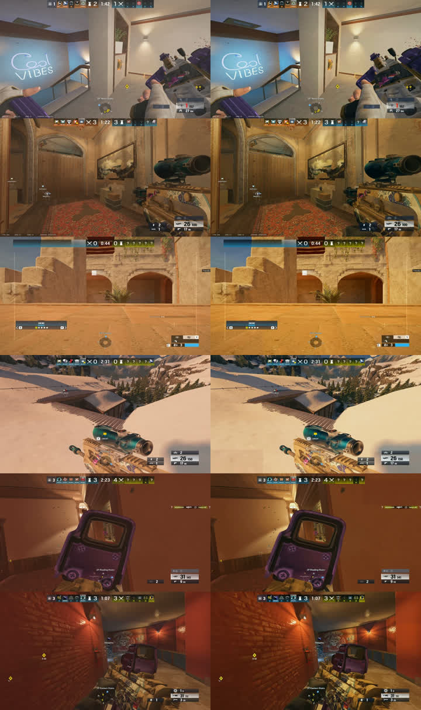

# Grading

Every saved clip is graded after the game closes. Retake measures the clip, corrects it, and applies a look, all baked into one 3D LUT per clip. The grade is constant for the whole clip, so it can't flicker when you walk from a dark room into daylight.

*Left: as recorded. Right: graded with the defaults. Bright indoor, warm indoor, desert, snow and two dark rooms; the dark rooms stay dark.*

## What happens to a clip

1. **Measure.** Keyframes are decoded at 640 px wide. Luma percentiles (0.5%, 50%, 99.5%) and the average colour of the midtones are taken, with the HUD masked out.
2. **Correct** (`exposure_amount`): black point towards 0.03, white point towards 0.95, median towards 0.42. A clip whose median is under 0.18 (night, basements) is only lifted a little.
3. **White balance** (`wb_amount`): per-channel gains that neutralise the midtone cast, never more than ±6%, so a map's own colour survives.
4. **Contrast and vibrance:** an S-curve around mid-grey, then a saturation boost that favours muted colours.
5. **Look** (`look`, `look_strength`): the built-in Siege look, or your own `.cube`.
6. **Render:** one ffmpeg pass in 16-bit RGB, luma sharpening (`sharpen`), HEVC Main10, every audio track copied.

With `output = "save_as"` (the default) the raw clip stays and `clip_graded.mkv` appears next to it. With `"overwrite"` the graded file replaces the raw clip, but only after it has been written and checked.

## Using your own look

1. Export the built-in look as a starting point: `retake.exe write-look luts\my-look.cube` (the release zip also has `luts\siege.cube`).
2. In DaVinci Resolve, put a few clips Retake graded with `look_strength = 0` on a timeline (indoor, outdoor, a night map, smoke). They are already normalised.
3. Grade one node: a little contrast, some saturation, shadows slightly cooler and highlights slightly warmer. Keep highlights below clipping on the waveform.
4. Check the node on all four clips without changing it; soften it until all four look right.
5. Right-click the node → *Generate LUT → 33 Point Cube* and save it as `luts\my-look.cube`.
6. Set `grade.look = "luts/my-look.cube"` in Settings (or `config.toml`). Use "Regrade last clip" in the tray to compare.

The look assumes Siege's in-game brightness stays where it was when you made it.

## Speed

A 58 s 1080p30 clip grades in about 20 s, and a 22 s 1440p clip at ~160 fps in about 60 s, on an RX 7900 XTX with a Ryzen 7 7800X3D. Grading runs at below-normal priority, only while the game is closed. Moving the colour pipeline to the GPU (libplacebo) is the next speed-up.
